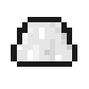
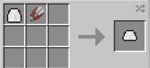
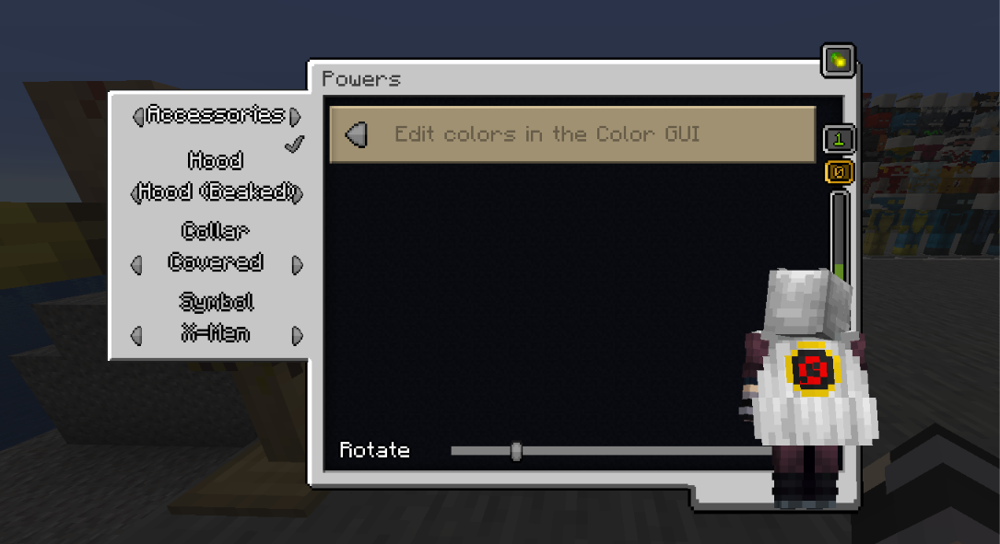

# Heroic (Short) Cape

{ width=100 height=100 loading=lazy }

**Heroic (Short) Cape** can be obtained via crafting with [Heroic Cape](heroic-cape.md) and Shear inside a crafting table.

{ width=275 height=126 loading=lazy }

Uses:

Using a [Glide Module](../../../items/technology/glide-module.md) you can glide with this cape.

You can adjust Primary / Secondary Colors and Accessories in power menu:

{ width=814 height=444 loading=lazy }
