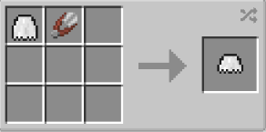

# Rogue (Short) Cape

{ width=100 height=100 loading=lazy }

**Rogue (Short) Cape** can be obtained via crafting with [Rogue Cape](rogue-cape.md) and shear inside a crafting table.

{ width=265 height=131 loading=lazy }

Uses:

Using a [Glide Module](../../../items/technology/glide-module.md) you can glide with this cape.

You can adjust Primary / Secondary Colors and Accessories in power menu:

{ width="814" height="444" loading=lazy }
