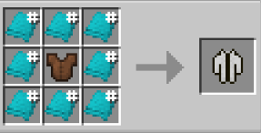

# Jacket (Long)

{ width=100 height=100 loading=lazy }

**Jacket (Long)** can be obtained via crafting with x8 any color [Basic Fabric](../../../items/technology/fabrics/basic-fabric.md) and Leather Chestplate inside a crafting table.

{ width=256 height=130 loading=lazy }

Uses:

A cosmetic curios:outerwear item to be worn.

You can adjust Primary / Secondary Colors in power menu, and accessories in Accessories menu:

{ width=432 height=247 loading=lazy }

{ width=435 height=231 loading=lazy }
