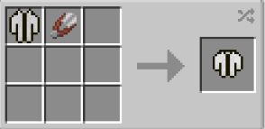
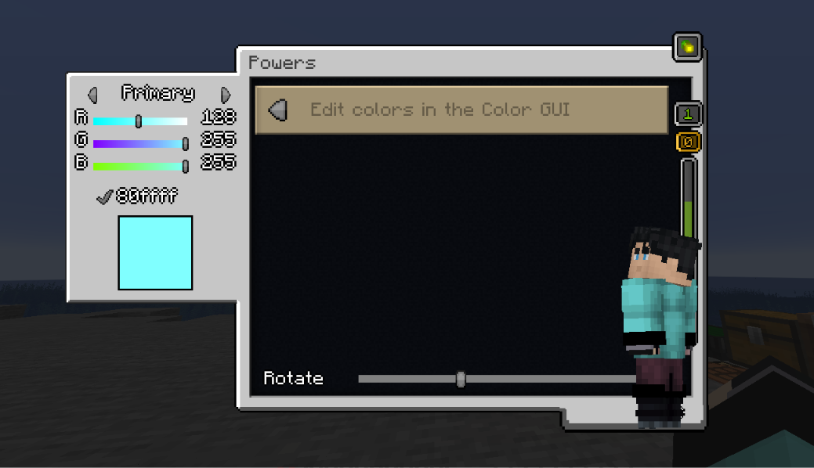
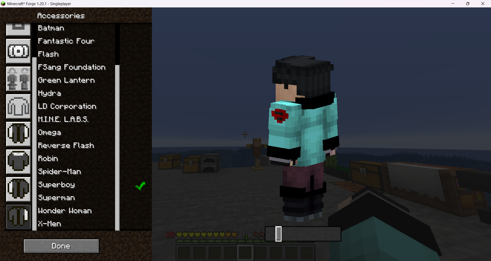

# Jacket (Short)

{ width=100 height=100 loading=lazy }

**Jacket (Short)** can be obtained via crafting with [Jacket (Long)](jacket-long.md) and shear inside a crafting table.

{ width=268 height=130 loading=lazy }

Uses:

A cosmetic curios:outerwear item to be worn.

You can adjust Primary / Secondary Colors in power menu, and accessories in Accessories menu:

{ width="432" height="247" loading=lazy }

{ width="435" height="231" loading=lazy }
