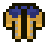
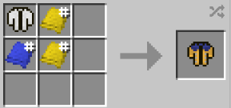

# Jacket (Short) - Wolverine Rivals

{ width="100" height="100" loading=lazy }

**Jacket (Short) - Wolverine Rivals** can be obtained via crafting with [Jacket (Short)](jacket-short.md), x2 Yellow Basic Fabric and x1 Blue Basic Fabric inside a crafting table.

{ width="217" height="102" loading=lazy }

Uses:

A cosmetic curios:outerwear item to be worn.

This jacket is designed to combine with [Wolverine (Rivals)](../../armorsets/wolverine-rivals.md) armorset.
