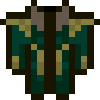
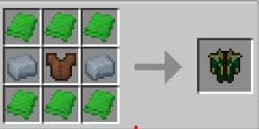

# Long Coat (Loki - God of Stories)

{ width="100" height="100" loading=lazy }

**Long Coat (Loki - God of Stories)** can be obtained via crafting with x6 Green [Basic Fabric](../../items/technology/fabrics/basic-fabric.md), x2 [Uru Ingot](../../blocks/ores/uru.md) and Leather Chestplate inside a crafting table.

{ width="272" height="136" loading=lazy }

Uses:

A cosmetic curios:outerwear item to be worn.

This long coat is designed to combine with [Loki (God of Stories)](../armorsets/loki-god-of-stories.md) armorset.
