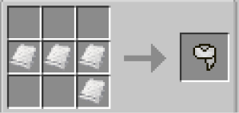

# Scarfs

{ width=82 height=82 loading=lazy }

**Scarfs** can be obtained via crafting with x4 [Basic Fabric](../../items/technology/fabrics/basic-fabric.md) (Color of fabric changes with which color you want your scarf to be) inside a crafting table.

{ width=390 height=41 loading=lazy }

{ width=289 height=137 loading=lazy }

Uses:

A cosmetic curios:necklace item to be worn.
