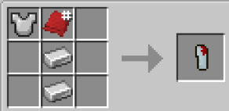

# Hydra

{ width=100 height=100 loading=lazy }{ width=100 height=100 loading=lazy }

**Winter Soldier Arm - Hydra** can be obtained via crafting with x1 Red Basic Fabric, x2 Iron Ingot and Iron Chestplate inside a crafting table.

{ width=262 height=128 loading=lazy }

Uses:

Equipping this arm in curios:hand slot while having [Winter Soldier](../../../powers/main-powers/super-soldiers/winter-soldier.md) power will grant you Offhand acces, Block ability and increased stats.

Using without Winter Soldier power is just cosmetic.

This arm has a Mainhand variant

{ width=246 height=121 loading=lazy }
