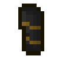
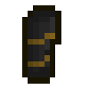
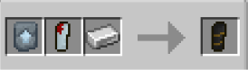
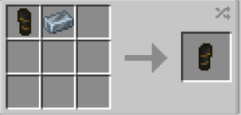

# Vibranium

{ width=124 height=124 loading=lazy }{ width=122 height=122 loading=lazy }

**Winter Soldier Arm - Vibranium** can be obtained via crafting with [Hydra Arm](hydra.md), Vibranium Template and Iron Ingot inside a smithing table.

{ width=284 height=81 loading=lazy }

Uses:

Equipping this arm in curios:hand slot while having [Winter Soldier](../../../powers/main-powers/super-soldiers/winter-soldier.md) power will grant you Offhand acces, Block ability and increased stats.

Using without Winter Soldier power is just cosmetic.

This arm has a Mainhand variant

{ width=223 height=107 loading=lazy }
