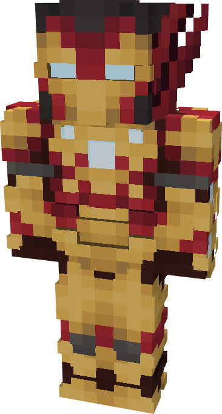

# Model Dragon Slayer

{ width="172" height="319" loading=lazy }

The Iron Man (Model Dragon Slayer) is crafted in the Tailoring Table with 4 Gold Circuits, 4 Diamond Circuits, a Template III suitset, 4 Red Reinforced Fabric, 6 Yellow Reinforced Fabric, 16 Eyes of Ender, and the Iron Man Model Dragon Slayer blueprint. The armor can be repaired in an anvil with [Bleeding Edge Stark Repair Kits](../../items/technology/stark-repair-kits/3-advanced-stark-repair-kit.md).

**Stats**:

* **Armor Rating:** 32
* **Armor Toughness:** 8
* **Attack Damage bonus:** +2
* **Flight Speed:** 1.6
* **Fall Resistance:** 51

**Abilities**:

* **Slot 1 (Non-Crouch)**: **"Repulsor Beam"** - Fire a continuous beam of repulsor energy that deals damage on hit that can be held for 10 seconds before needing to recharge. This armor has an adjustable repulsor damage output up to a max of 4 that can be adjusted by crouching and using the ability key:
  * Output 1 - 5 damage
  * Output 2 - 8 damage
  * Output 3 - 13 damage
* **Slot 2 (Non-Crouch): "Unibeam"** - Fire a continuous beam of repulsor energy from your chest reactor that deals damage 18 on hit that can be held down for 5 seconds before needing to recharge.
  * Output 1 - 18 damage
  * Output 2 - 22 damage
  * Output 3 - 26 damage
* **Slot 3 (Non-Crouch): "Sonic Beam" -** Fire off high frequency sound waves and apply **Sound Poisoning** and **Slowness II**.
* **Slot 4 (Non-Crouch): "Enable Energy Shield" -** Channel repulsor energy through the two ports on your arm, enabling an energy shield that drains energy passively. It can be held for 15 seconds before needing to recharge.Crouching and using the ability key will disable the ability.
* **Slot 5 (Non-Crouch): "Enable Energy Lance" -** Channel repulsor energy through your gauntlet, enabling an energy lance that drains energy passively. While active, it will increase your physical damage by 10. Pressing the key again charges up a forward lunge with the lance that deals 20 damage. Crouching and using the ability key will disable the ability.

**Related Information**

This Suits's recipe becomes unlocked after crafting the Model NIL suit.
