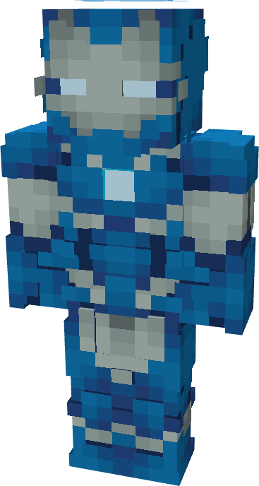

# Model V

{ width="200" height="373" loading=lazy }

The **Rescue (Model V)** is crafted in the Tailoring Table with 2 Gold Circuits, 2 Diamond Circuits, a Template II suitset, 6 Blue Reinforced Fabric, 6 Light Gray Reinforced Fabric, and the Rescue Model V blueprint. The armor can be repaired in an anvil with [Modular Stark Repair Kits](../../../items/technology/stark-repair-kits/2-enhanced-stark-repair-kit.md).

**Stats**:

* **Armor Rating:** 28
* **Armor Toughness:** 8
* **Attack Damage bonus:** +2
* **Flight Speed:** 1.6
* **Fall Resistance:** 51

**Abilities**:

* **Slot 1 (Non-Crouch)**: **"Repulsor Beam"** - Fire a continuous beam of repulsor energy that deals damage on hit that can be held for 10 seconds before needing to recharge. This armor has an adjustable repulsor damage output up to a max of 4 that can be adjusted by crouching and using the ability key:
  * Output 1 - 5 damage
  * Output 2 - 8 damage
  * Output 3 - 13 damage
  * Output 4 - 16 damage
* **Slot 2 (Non-Crouch): "Unibeam"** - Fire a continuous beam of repulsor energy from your chest reactor that deals damage 18 on hit that can be held down for 5 seconds before needing to recharge.
* **Slot 3 (Crouch):** **"Swap Munitions"** - Crouching and using the ability key gives you the option to change the type of munition that will be fired:
  * **"Concussive Blast"** - fire off a burst of concussive wind which inflicts the target with Sound Poisoning for 4 seconds which applies Slowness II, Nausea II, and 2 sound damage over time.
  * **"Taser Launcher"** - Fire a single electric charge which inflicts Shock II and EMP, for 5 seconds which deals 2 shock damage over time and disables the target’s technology based powers.
* **Slot 4 (Non-Crouch):** **"Energy Shield"** - Project a bubble around yourself that locks movement and blocks any incoming damage that can be held for 15 seconds before needing to recharge.
* **Slot 5 (Non-Crouch):** **"Entity Telekinesis"** - channel energy into vectored repulsor fields that can hold an entity in place. Using the scroll wheel can change the range at which the held entity is kept at. Crouching and pressing this key allows you to activate another ability.
  * **"Activate Thrusters"** - Activate the back mounted thrusters which boosts flight speed to 2.25. Press the ability key again to disable thrusters.

**Related Information**

* This Suits's recipe becomes unlocked after crafting the Model LVI suit.
