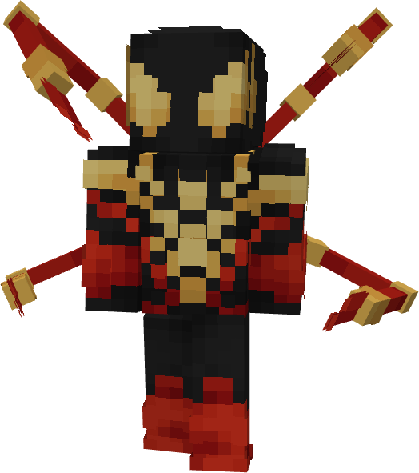

# Model I - Miles

{ width=300 height=337 loading=lazy }

The **Iron Spider (Model I - Miles)** is crafted in the Tailoring Table with 2 Gold Circuits, 2 Diamond Circuits, a Template II suitset, 8 Reinforced Black Fabric, 4 Reinforced Red Fabric, 1 Advanced Web Shooter and the Iron Spider Model I - Miles blueprint. The armor can be repaired in an anvil with [Stark Repair Kits](../../../items/technology/stark-repair-kits/1-basic-stark-repair-kit.md).

**Stats**:

* **Armor Rating:** 28
* **Armor Toughness:** 8
* **Base Attack Damage:** +2
* **Flight Speed: N / A**

**Main Abilities**:

* **Slot 1 (Non-Crouch)**: **"Repulsor Beam"** - Fire a continuous beam of repulsor energy that deals damage on hit that can be held for 10 seconds before needing to recharge. This armor has an adjustable repulsor damage output up to a max of 4 that can be adjusted by crouching and using the ability key:
  * Output 1 - 5 damage
  * Output 2 - 8 damage
* **Slot 2 (Non-Crouch): "Waldoe Control"** - Open up your waldoes to use your waldo related abilities. After enabling them you can use the following abilities in the ability wheel:
  * **"Spider Jab" -** Use your waldoes to strike your target with a jab attack and deal 12 damage.
  * **"Waldoes Guard" -** Use your waldoes to cover yourself and block any incoming attack.
  * **"Open Waldoes" -** Open your waldoes.
  * **"Close Waldoes"** - Close your waldoes.
* **Slot 3 (Non-Crouch): "Enable Web Mode" -** Enable your web mode to do web tricks. Web Swing with Right-Click, and Web Zip with Left-Click.
  * **"Web Zip" -** Attach a web to a block within 30 blocks in the direction you are looking to be pulled towards it. This ability costs 2 WF when used (even if your target is out of range).
  * **"Web Swing"** - Shoot a web line to swing between structures.
* **Slot 2 (Crouch): "Change Web-Type"** - Switch through all of your available web types in your 4th Slot.
  * "**Web Shot"** - Fire off a high velocity ball of webs which can deal 2 damage when a target is hit. This ability costs 5 WF and has a cooldown of 1/4 seconds.
  * **"Impact Web Blast"** - Fire off a larger ball of webs which can deal 6 damage when a target is hit, and will trap them in a cobweb. This ability costs 20 WF and has a cooldown of 2 seconds.
  * **"Concussion Web Blast"** - Fire off a ball of webs which can deal 1 damage when a target is hit, and hot with a Knockback of 3. This ability costs 15 WF and has a cooldown of 2 seconds.
  * **"Shock Web Blast"** - Fire off a ball of webs enhanced by electricity which can deal 2 damage when a target is hit, and applies the Shock effect for 4 seconds on the target that is hit. This ability costs 25 WF and has a cooldown of 2 seconds.
  * **"Web Grenade"** - Fire off a large ball of condensed webs which can deal 6 damage when a target is hit, and creates a non-destructive explosion when hit. This ability costs 50 WF and has a cooldown of 3 seconds.

**Related Information**:

* This Suits's recipe becomes unlocked after crafting the Iron Spider Model I suit.
