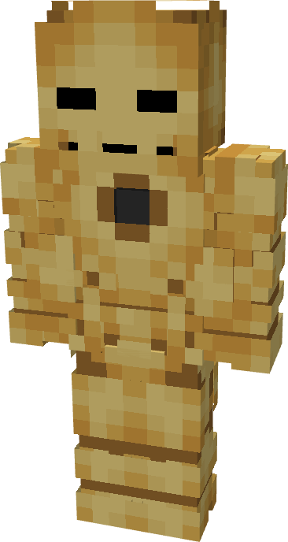

# Model I, MK III

{ width="192" height="360" loading=lazy }

The **Iron Man (Model I Mk III)** is crafted in the Tailoring Table with 1 Iron Circuit, 1 Gold Circuit, an Iron Man Model I suitset, and the Iron Man Model I Mk III blueprint. The armor can be repaired in an anvil with [Basic Stark Repair Kit](../../items/technology/stark-repair-kits/1-basic-stark-repair-kit.md).

**Stats:**

* **Armor Rating:** 20
* **Armor Toughness:** 4
* **Attack Damage bonus:** +8
* **Flight Speed:** 0.35

**Abilities:**

* **Slot 1 (Non-Crouch): "Flamethrower"** - Fire off a projectile of flames that does 5 damage on hit and leaves fire when hitting the ground. It can be held for 10 seconds before needing to recharge.

**Related Information**

* This Suits's recipe becomes unlocked after crafting the Model I suit.
