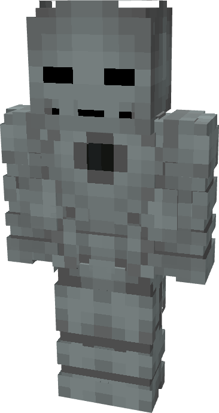

# Model I

{ width="213" height="399" loading=lazy }

**"Iron Man Model I"** is obtained via  in the Tailoring Table with x1 Iron Circuit, x1 Gold Circuit, a Template I suitset, with the Iron Man (Model I) blueprint and can be repaired via "[Basic Stark Repair Kit](../../items/technology/stark-repair-kits/1-basic-stark-repair-kit.md)" in an anvil.

**Stats:**

* **Armor Rating:** 20
* **Armor Toughness:** 4
* **Attack Damage bonus:** +6
* **Flight Speed:** 0.3

**Abilities:**

* **Slot 1 (Non-Crouch):** **"Flamethrower"** - Fire off a projectile of flames that does 5 damage on hit and leaves fire when hitting the ground. Can be held down for 10 seconds before needing to recharge.
