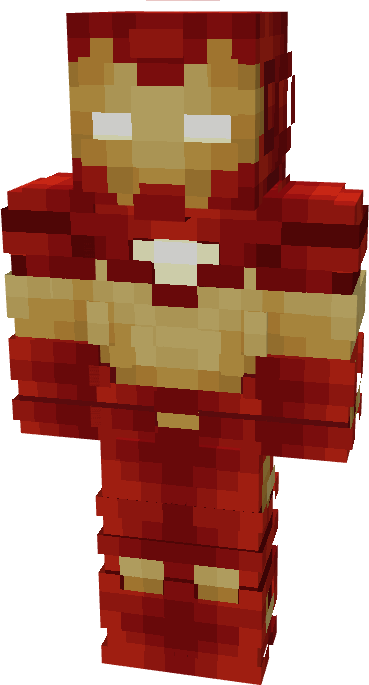

# Model XIII

{ width="194" height="359" loading=lazy }

The b is crafted in the Tailoring Table with x2 Gold Circuits, x2 Diamond Circuits, a Template II suitset, x4 Red Reinforced Fabric, x8 Yellow Reinforced Fabric, and the Iron Man Model XIII blueprint and can be repaired in an anvil with [Modular Stark Repair Kits](../../items/technology/stark-repair-kits/2-enhanced-stark-repair-kit.md).

**Stats**:

* **Armor Rating:** 28
* **Armor Toughness:** 8
* **Attack Damage bonus:** +2
* **Flight Speed:** 1.1
* **Fall Resistance:** 31

**Abilities**:

* **lot 1 (Non-Crouch)**: **"Repulsor Beam"** - Fire a continuous beam of repulsor energy that deals 5 damage on hit that can be held for 10 seconds before needing to recharge.
* **Slot 2 (Non-Crouch): "Unibeam"** - Fire a continuous beam of repulsor energy from your chest reactor that deals 18 damage on hit that can be held for 5 seconds before needing to recharge
* **Slot 3 (Non-Crouch)**: **"Kinetic Micro-Missile"** - Fire a medium range missile that explodes on impact, dealing 10 explosive damage.
* **Slot 4 (Non-Crouch)**: **"Flares"** - Fire off a barrage of firework flares behind you for 3 seconds to deal low damage and hinder visibility, with a cooldown of 10 seconds before next use.

**Related Information**

* This Suits's recipe becomes unlocked after crafting the Model IX suit.
