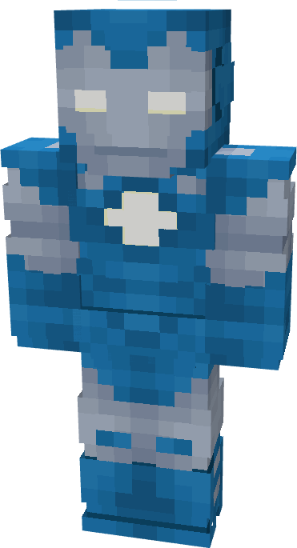

# Model XIV

{ width="161" height="297" loading=lazy }

The **Iron Man (Model XIV)** is crafted in the Tailoring Table with x2 Gold Circuits, x2 Diamond Circuits, a Template II suitset, x4 Blue Reinforced Fabric, x4 Gray Reinforced Fabric, and the Iron Man Model XIV blueprint. The armor can be repaired in an anvil with [Modular Stark Repair Kits](../../items/technology/stark-repair-kits/2-enhanced-stark-repair-kit.md).

**Stats**:

* **Armor Rating:** 28
* **Armor Toughness:** 8
* **Attack Damage bonus:** +2
* **Flight Speed:** 1.1
* **Fall Resistance:** 31

**Abilities:**

* **Slot 1 (Non-Crouch)**: **"Repulsor Beam"** - Fire a continuous beam of repulsor energy that deals 5 damage on hit that can be held for 10 seconds before needing to recharge.
* **Slot 2 (Non-Crouch): "Unibeam"** - Fire a continuous beam of repulsor energy from your chest reactor that deals 18 damage on hit that can be held for 5 seconds before needing to recharge.
* **Slot 3 (Non-Crouch):** **"Kinetic Micro-Missile"** - Fire a medium range missile that explodes on impact, dealing 10 explosive damage.
* **Slot 4 (Non-Crouch): "Flamethrower"** - Fire off a projectile of flames that does 5 damage on hit and leaves fire when hitting the ground. Can be held down for 10 seconds before needing to recharge.

**Additional Information**:

* This armor has complete immunity to vanilla freeze damage.
* This Suits's recipe becomes unlocked after crafting the Model XIII suit.
