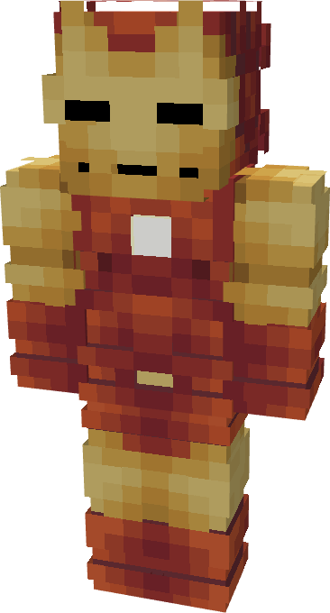

# Model II

{ width="214" height="397" loading=lazy }

**"Iron Man Model II"** crafted in the Tailoring Table with 2 Iron Circuits, 2 Gold Circuits, a Template I suitset, 6 Red Fabric, 6 Yellow Fabric, and the Iron Man Model II blueprint and can be repaired via "[Basic Stark Repair Kit](../../items/technology/stark-repair-kits/1-basic-stark-repair-kit.md)" in an anvil.

**Stats**:

* **Armor Rating:** 20
* **Armor Toughness:** 4
* **Attack Damage bonus:** +2
* **Flight Speed:** 0.5
* **Fall Resistance:** 11

**Main Abilities**:

* **Slot 1 (Non-Crouch): Repulsor Blast** - Fire a single shot of repulsor energy that deals 3 damage on hit, with a cooldown of 1 second before you can fire again.

**Related Information**

* This Suits's recipe becomes unlocked after crafting the Model I suit.
