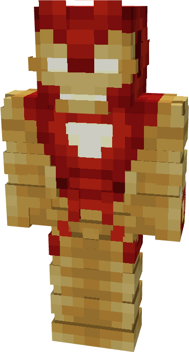

# Model XXII

{ width="178" height="329" loading=lazy }

The **Iron Man (Model XXII)** is crafted in the Tailoring Table with x2 Gold Circuits, x2 Diamond Circuits, x1 Uru Template, a Template III suitset, x4 Red Reinforced Fabric, x8 Yellow Reinforced Fabric, x1 Nether Star, and the Iron Man Model XXII blueprint. The armor can be repaired in an anvil with [Modular Stark Repair Kits](../../items/technology/stark-repair-kits/2-enhanced-stark-repair-kit.md).

**Stats**:

* **Armor Rating:** 34
* **Armor Toughness:** 12
* **Attack Damage bonus:** +6
* **Flight Speed:** 0.4
* **Fall Resistance:** 81

**Abilities:**

* **Slot 1 (Non-Crouch)**: **"Repulsor Beam"** - Fire a continuous beam of repulsor energy that deals damage on hit that can be held for 10 seconds before needing to recharge. This armor has an adjustable repulsor damage output up to a max of 2 that can be adjusted by crouching and using the ability key:
  * Output 1 - 5 damage
  * Output 2 - 8 damage
* **Slot 2 (Non-Crouch): "Unibeam"** - Fire a continuous beam of repulsor energy from your chest reactor that deals 18 damage on hit that can be held down for 5 seconds before needing to recharge.

**Additional Information**:

* This armor is completely immune to lightning damage. Additionally, the repulsors and unibeam deal magic damage rather than regular energy damage.
* This Suits's recipe becomes unlocked after crafting the Model XVI suit.
