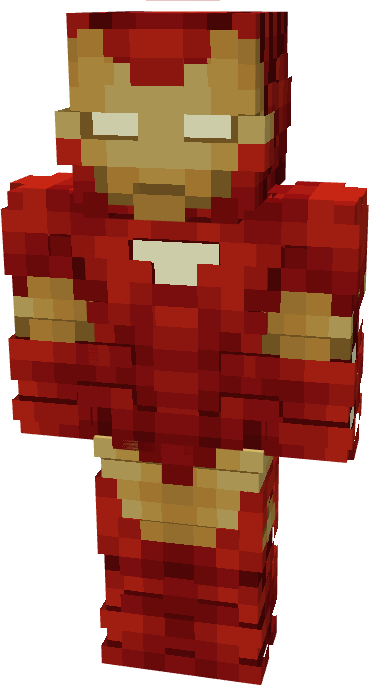

# Model XXV

{ width="132" height="244" loading=lazy }

The **Iron Man (Model XXV)** is crafted in the Tailoring Table with x2 Gold Circuits, x2 Diamond Circuits, a Template II suitset, x4 Red Reinforced Fabric, x8 Yellow Reinforced Fabric, and the Iron Man Model XXV blueprint. The armor can be repaired in an anvil with [Modular Stark Repair Kits](../../items/technology/stark-repair-kits/2-enhanced-stark-repair-kit.md).

**Stats**:

* **Armor Rating:** 28
* **Armor Toughness:** 8
* **Attack Damage bonus:** +2
* **Flight Speed:** 1.3
* **Fall Resistance:** 41

**Abilities:**

* **Slot 1 (Non-Crouch)**: **"Repulsor Beam"** - Fire a continuous beam of repulsor energy that deals damage on hit that can be held for 10 seconds before needing to recharge. This armor has an adjustable repulsor damage output up to a max of 2 that can be adjusted by crouching and using the ability key:
  * Output 1 - 5 damage
  * Output 2 - 8 damage
* **Slot 2 (Non-Crouch): "Unibeam"** - Fire a continuous beam of repulsor energy from your chest reactor that deals 18 damage on hit that can be held down for 5 seconds before needing to recharge.
* **Slot 3 (Crouch):** **"Swap Munitions"** - crouching and using the ability key gives you the option to change the type of munition that will be fired:
  * **"Kinetic Micro Missile"** - Fire a medium range missile that explodes on impact, dealing 3 explosive damage.
  * **"Concussive Blast"** - fire off a burst of concussive wind which inflicts the target with Sound Poisoning for 4 seconds which applies Slowness II, Nausea II, and 2 sound damage over time.
* **Slot 4 (Non-Crouch):** **"Energy Shield"** - Project a bubble around yourself that locks movement and blocks any incoming damage that can be held for 10 seconds before needing to recharge.

**Related Information**

* This Suits's recipe becomes unlocked after crafting the Model XXII suit.
