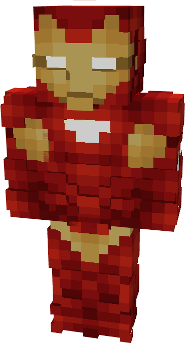

# Model XXIX

{ width="189" height="350" loading=lazy }

The **Iron Man (Model XXIX)** is crafted in the Tailoring Table with x3 Gold Circuits, x3 Diamond Circuits, a Template II suitset, x4 Red Reinforced Fabric, x8 Yellow Reinforced Fabric, and the Iron Man Model XXIX blueprint. The armor can be repaired in an anvil with [Modular Stark Repair Kits](../../items/technology/stark-repair-kits/2-enhanced-stark-repair-kit.md).

**Stats**:

* **Armor Rating:** 28
* **Armor Toughness:** 8
* **Attack Damage bonus:** +2
* **Flight Speed:** 1.35
* **Fall Resistance:** 41

**Abilities:**

* **Slot 1 (Non-Crouch)**: **"Repulsor Beam"** - Fire a continuous beam of repulsor energy that deals damage on hit that can be held for 10 seconds before needing to recharge. This armor has an adjustable repulsor damage output up to a max of 2 that can be adjusted by crouching and using the ability key:
  * Output 1 - 5 damage
  * Output 2 - 8 damage
* **Slot 2 (Non-Crouch): "Unibeam"** - Fire a continuous beam of repulsor energy from your chest reactor that deals 18 damage on hit that can be held down for 5 seconds before needing to recharge.
* **Slot 3 (Non-Crouch):** **"Micro-Munition Barrage"** - continuously fire a barrage of micro munitions from your gauntlets that deal 3 explosion damage on hit that can be held for 6 seconds before needing to recharge.
* **Slot 4 (Non-Crouch): "Energy Shield"** - Project a bubble around yourself that locks movement and blocks any incoming damage that can be held for 10 seconds before needing to recharge.

**Additional Information**:

* This armor’s energy shield is immune to explosion damage.
* This Suits's recipe becomes unlocked after crafting the Model XXV suit.
