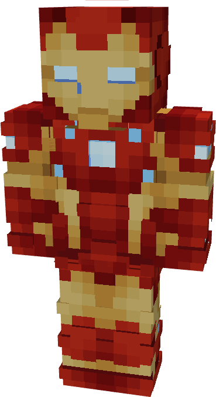
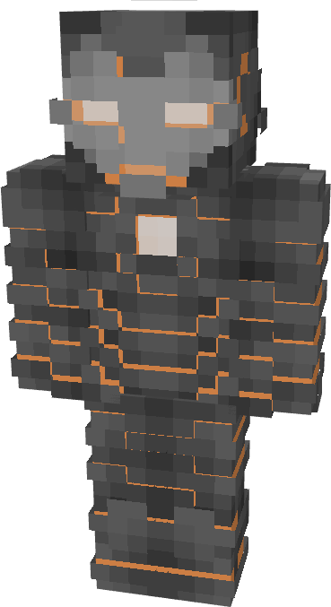

# Model XXXVII (Nano Suit)

{ width="170" height="310" loading=lazy } { width="169" height="308" loading=lazy }

The **Iron Man (Model XXIX)** is crafted in the Tailoring Table with x4 Arc Reactor Cores, x3 Gold Circuits, x3 Diamond Circuits, a Template II suitset, x2 Uru Templates, and the Iron Man Model XXXVII blueprint.\
The armor can be repaired automatically by refilling Nanites while transformed or in a smithing table with an Uru Smithing Template and a [Modular Stark Repair Kit](../../items/technology/stark-repair-kits/2-enhanced-stark-repair-kit.md).

**Stats (Base)**:

* **Armor Rating:** 28
* **Armor Toughness:** 8
* **Attack Damage bonus:** +2\
  **Flight Speed:** 1.5
* **Fall Resistance:** 41

**Stats (Iron Destroyer)**:

* **Armor Rating:** 38
* **Armor Toughness:** +6
* **Attack Damage bonus:** +6
* **Attack Knockback:** +2

**Abilities:**

* **Slot 1 (Non-Crouch)**: **"Repulsor Beam"** - Fire a continuous beam of repulsor energy that deals damage on hit that can be held for 10 seconds before needing to recharge. This armor has an adjustable repulsor damage output up to a max of 2 that can be adjusted by crouching and using the ability key:
  * Output 1 - 5 damage
  * Output 2 - 8 damage
* **Slot 2 (Non-Crouch): "Unibeam"** - Fire a continuous beam of repulsor energy from your chest reactor that deals 18 damage on hit that can be held down for 5 seconds before needing to recharge.
* **Slot 3 (Non-Crouch):** **"Kinetic Micro-Missile"** - Fire a medium range missile that explodes on impact at the cost of Nanites, dealing 15 explosive damage.
* **Slot 4 (Non-Crouch):** **"Weapon Changer"** - Use your nanites to transform your hands into weopons:
  * "**Disable Tools"** - Retract the Nanites used to form the currently active tool.
  * **"Repulsor Cannon"** - Form your suit’s excess Nanites into a cannon to buff your repulsor damage by 5.
  * **"Energy Blade"** - Focus repulsor energy into a blade of pure energy coming from the repulsor core on your gauntlet, giving you 5 damage per hit at the cost of high energy drain.
* **Slot 5 (Non-Crouch):** **"Iron Destroyer"** - Activate the imbued enchanted Uru within the reactor to increase your armor rating +10 and gain armor toughness +6, as well as bolstering the damage of your repulsors and strikes +4 at the cost of Nanites over time.
  * Crouch using this ability will deactivate the form. This transformation also gives you access to an exclusive ability.
* **Slot 5 (Non-Crouch, Iron Destroyer):** **"Ground Stomp"** - Stomp the ground with immense force creating an explosion and dealing 15 damage to nearby entities.

**Additional Information**:

* The armor is contained within and solely powered by the Nano Housing Unit (Model XXXVII). This means that the armor is self repairing as long as its Nanite count is filled. **It can be activated and deactivated with transformation key, default keybind is R.**
* This armor has complete immunity to vanilla fire damage.
* This Suits's recipe becomes unlocked after crafting the Model XXIX suit.
