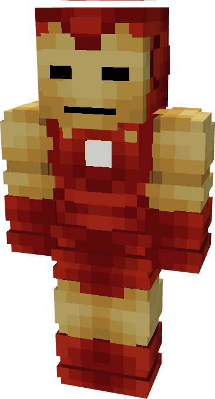

# Model IV

{ width="192" height="356" loading=lazy }

**"Iron Man Model IV"** is crafted in the Tailoring Table with 2 Iron Circuits, 2 Gold Circuits, a Template I suitset, 6 Red Fabric, 6 Yellow Fabric, and the Iron Man Model IV blueprint and can be repaired via "[Basic Stark Repair Kit](../../items/technology/stark-repair-kits/1-basic-stark-repair-kit.md)" in an anvil.

**Stats**:

* **Armor Rating:** 20
* **Armor Toughness:** 4
* **Attack Damage bonus:** +2
* **Flight Speed:** 1
* **Fall Resistance:** 21

**Main Abilities**:

* **Slot 1 (Non-Crouch): "Repulsor Blast"** - Fire a single shot of repulsor energy that deals 3 damage on hit, with a cooldown of 1 second before you can fire again. 
* **Slot 2 (Non-Crouch)** "**Repulsor Beam"** - Fire a continuous beam of repulsor energy that deals 5 damage on hit that can be held for 10 seconds before needing to recharge.

**Related Information**

* This Suits's recipe becomes unlocked after crafting the Model III suit.
