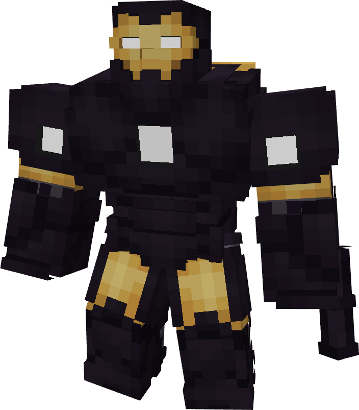

# Model LXIV (Hulkbuster)

{ width="302" height="343" loading=lazy }

The **Iron Man (Model LXIV) Hulkbuster** is crafted in the Tailoring Table with x3 Netherite Circuits, x3 Titanium Circuits, a Template IV suitset, x4 Black Tri Polymer Fabric, x8 Yellow Tri Polymer Fabric, and the Iron Man Model XLIV blueprint. The durability of this armor resets when re-equipped.

**Stats**:

* **Armor Rating:** 34
* **Armor Toughness:** 8
* **Attack Damage bonus:** +8
* **Levitation Speed:** 0.35

**Abilities:**

* **Slot 1 (Non-Crouch)**: **"Repulsor Beam"** - Fire a continuous beam of repulsor energy that deals damage on hit that can be held for 10 seconds before needing to recharge. This armor has an adjustable repulsor damage output up to a max of 2 that can be adjusted by crouching and using the ability key:
  * Output 1 - 10 damage
  * Output 2 - 16 damage
* **Slot 2 (Non-Crouch): "Unibeam"** - Fire a continuous beam of repulsor energy from your chest reactor that deals 25 damage on hit that can be held down for 5 seconds before needing to recharge.
* **Slot 3 (Non-Crouch):** "**Minigun Shots**" - Rev up the arm mounted minigun and fire off rapid fire shots that deal 6 damage on hit that can be held for 10 seconds before needing to recharge. Each hit applies Wither III on the target for 3 seconds.

**Additional Information**:

* Due to the large size of the armor, the player is 3 blocks tall and is unable to hold any regular items. In combination with the Netherite plating, this armor is immune to explosion and arrow damage. Additionally, its abilities will drain larger amounts of power than a standard Iron Man armor.
* This armor is able to punch with both left and right click, allowing for alternating punches that deal physical damage quicker than normally possible.
* This Suits's recipe becomes unlocked after crafting the Model XLII suit.
