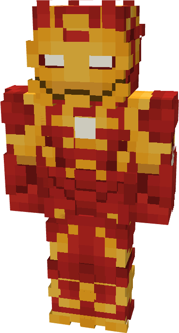

# Model XLV

{ width="173" height="319" loading=lazy }

The **Iron Man (Model XLV)** is crafted in the Tailoring Table with x3 Gold Circuits, x3 Diamond Circuits, a Template II suitset, x6 Red Reinforced Fabric, x8 Yellow Reinforced Fabric, x1 Conduit, and the Iron Man Model XLV blueprint. The armor can be repaired in an anvil with [Modular Stark Repair Kits](../../items/technology/stark-repair-kits/2-enhanced-stark-repair-kit.md).

**Stats**:

* **Armor Rating:** 28
* **Armor Toughness:** 8
* **Attack Damage bonus:** +2
* **Flight Speed:** 1.6
* **Fall Resistance:** 51

**Abilities:**

* **Slot 1 (Non-Crouch)**: **"Repulsor Beam"** - Fire a continuous beam of repulsor energy that deals damage on hit that can be held for 10 seconds before needing to recharge. This armor has an adjustable repulsor damage output up to a max of 3 that can be adjusted by crouching and using the ability key:
  * Output 1 - 5 damage
  * Output 2 - 8 damage
  * Output 3 - 13 damage
* **Slot 2 (Non-Crouch): "Unibeam"** - Fire a continuous beam of repulsor energy from your chest reactor that deals 18 damage on hit that can be held down for 5 seconds before needing to recharge.
* **Slot 3 (Non-Crouch):** **"Kinetic Micro Missile"** - Fire a medium range missile that explodes on impact, dealing 3 explosive damage.
* **Slot 4 (Non-Crouch):** **"Energy Shield"** - Project a bubble around yourself that locks movement and blocks any incoming damage that can be held for 15 seconds before needing to recharge.
* **Slot 5 (Non-Crouch):** **"Activate Thrusters"** - Activate the back mounted thrusters which boosts flight speed to 2.25. Press the ability key again to disable thrusters.

**Additional Information**:

* This armor enables the wearer to survive in Ad-Astra space as long as the helmet is closed.
* This Suits's recipe becomes unlocked after crafting the Model XLII suit.
