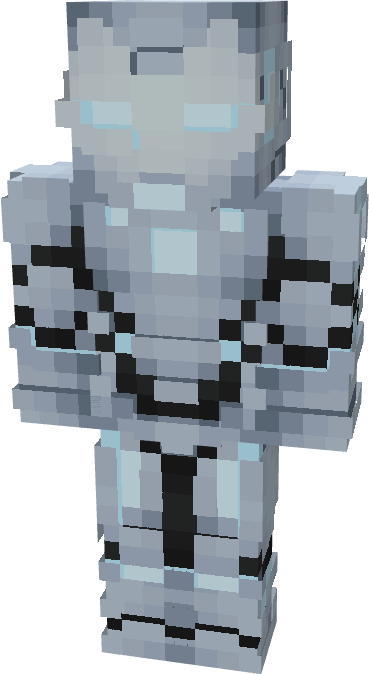
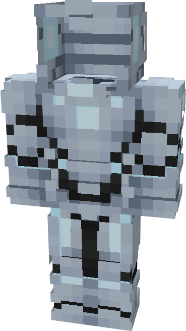
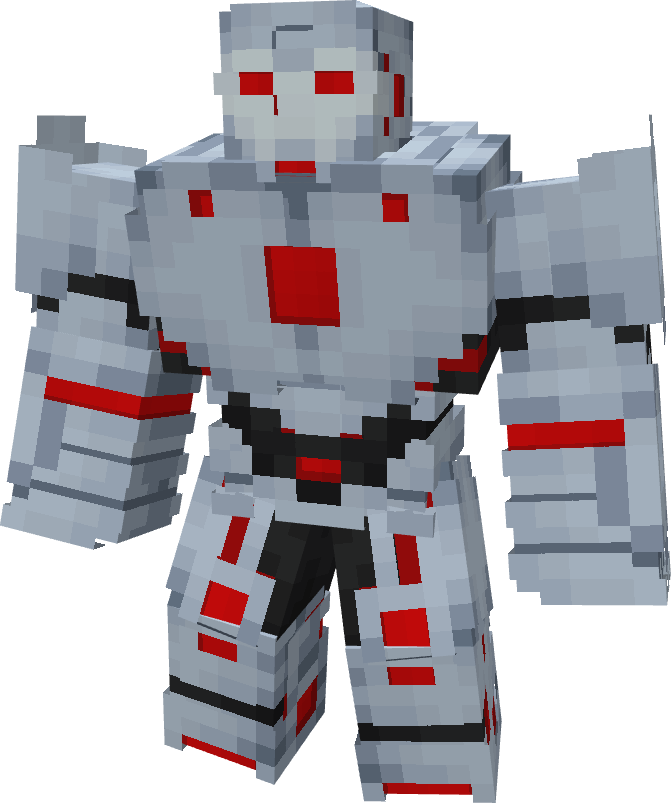

# Model L

{ width="147" height="268" loading=lazy }{ width="150" height="266" loading=lazy }

The **Iron Man (Model L)** is crafted in the Tailoring Table with x4 Gold Circuits, x4 Diamond Circuits, x48 Nanites, a Template II suitset, any filled Artificial Symbiote Container, and the Iron Man Model L blueprint.\
The armor can be repaired automatically by refilling Nanites while transformed or in a smithing table with an Vibranium Smithing Template and a [Modular Stark Repair Kit](../../items/technology/stark-repair-kits/2-enhanced-stark-repair-kit.md) if any single piece of it becomes broken. 

**Stats**:

* **Armor Rating:** 28
* **Armor Toughness:** 8
* **Attack Damage bonus:** +2
* **Flight Speed:** 1.75
* **Fall Resistance:** 61

**Abilities**:

* **lot 1 (Non-Crouch)**: **"Repulsor Beam"** - Fire a continuous beam of repulsor energy that deals damage on hit that can be held for 10 seconds before needing to recharge. This armor has an adjustable repulsor damage output up to a max of 4 that can be adjusted by crouching and using the ability key:
  * Output 1 - 5 damage
  * Output 2 - 8 damage
  * Output 3 - 13 damage
  * Output 4 - 16 damage
* **Slot 2 (Non-Crouch): "Unibeam"** - Fire a continuous beam of repulsor energy from your chest reactor that deals damage on hit that can be held down for 5 seconds before needing to recharge. This armor has an adjustable repulsor damage output up to a max of 4 that can be adjusted by crouching and using the ability key:
  * Output 1 - 18 damage
  * Output 2 - 22 damage
* **Slot 3 (Non-Crouch):** **"Weapon Changer"** - Crouching and using the ability key gives you the option to transform the weapon on this ability at the cost of Nanites:
  * **"Kinetic Micro Missile"** - Fire a medium range missile that explodes on impact, dealing 3 explosive damage.
  * **"Taser Launcher"** - Fire a single electric charge which inflicts Shock II and EMP, for 5 seconds which deals 2 shock damage over time and disables the target’s technology based powers.
  * "**Concussive Blast"** - fire off a burst of concussive wind which inflicts the target with Sound Poisoning for 4 seconds which applies Slowness II, Nausea II, and 2 sound damage over time.
  * **"Symbiotic Tendrils"** - Form your suit’s nanites into piercing tendrils that shoot out in a 1 block radius and deal 5 damage.
  * **"Energy Cannons"** - Form your suit’s excess Nanites into a repulsor cannon array to buff your repulsor damage by 5.
* **Slot 4 (Non-Crouch):** **"Energy Shield"** - Project a bubble around yourself that locks movement and blocks any incoming damage that can be held for 15 seconds before needing to recharge.
* **Slot 5 (Non-Crouch):** **"Superior Mode"** - Gather your excess Nanites to increase your size into a hulkbuster-like form, gaining new abilities.

**Additional Information**:

* The armor is contained within and solely powered by the Endo Sym Housing Unit (Model L). This means that the armor is self repairing as long as its Nanite count is filled. It can be activated and deactivated by pressing crouch and right clicking.
* This armor has complete immunity to sound damage.
* This Suits's recipe becomes unlocked after crafting the Model XLV suit.

**Superior Mode:**

{ width="298" height="356" loading=lazy }

**Stats:**

* **Armor Rating:** 34
* **Armor Toughness:** 8
* **Attack Damage bonus:** +8
* **Levitation Speed:** 0.2
* **Fall Resistance:** 61

**Abilities:**

* **Slot 1 (Non-Crouch)**: **"Repulsor Beam"** - Fire a continuous beam of repulsor energy that deals damage on hit that can be held for 10 seconds before needing to recharge. This armor has an adjustable repulsor damage output up to a max of 2 that can be adjusted by crouching and using the ability key:
  * Output 1 - 10 damage
  * Output 2 - 16 damage
* **Slot 2 (Non-Crouch): "Unibeam"** - Fire a continuous beam of repulsor energy from your chest reactor that deals 25 damage on hit that can be held down for 5 seconds before needing to recharge.
* **Slot 3 (Non-Crouch):** **"Symbiotic Tendrils"** - Form your suit’s nanites into large piercing tendrils that shoot out in a 4 block radius and deal 8 damage.
* **Slot 4 (Non-Crouch):** **"Ground Stomp"** - Stomp the ground with immense force creating an explosion and dealing 21 explosion damage to nearby entities.
* **Slot 5 (Non-Crouch):** "Deactivate Superior Mode" - Retract your suit’s Nanites and revert to the normal Model L.

**Additional Information:**

* Due to the large size of the armor, the player is 3 blocks tall and is unable to hold any regular items. Additionally, its abilities will drain larger amounts of power than a standard Iron Man armor. 
* This armor is able to punch with both left and right click, allowing for alternating punches that deal physical damage quicker than normally possible. 
* This armor has complete immunity to sound damage.
