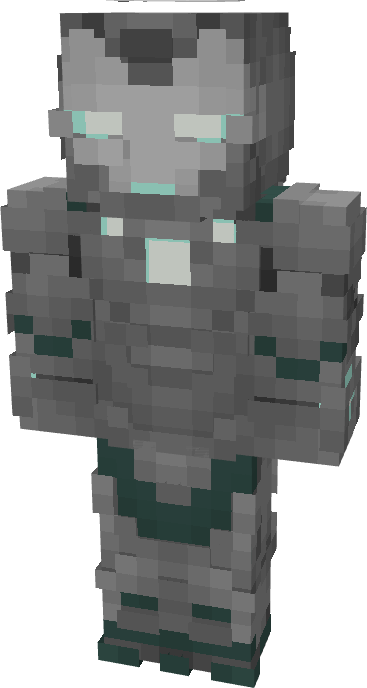

# Model LI - DOOM

{ width=160 height=298 loading=lazy }

The Iron Man (Model LI -DOOM) is crafted in the Tailoring Table with 4 Gold Circuits, 4 Diamond Circuits, an Iron Man (Model LI) suitset, 6 Green Reinforced Fabric, 6 Light Gray Reinforced Fabric, and the Iron Man Model LI (DOOM) blueprint. The armor can be repaired in an anvil with [Modular Stark Repair Kits](../../items/technology/stark-repair-kits/2-enhanced-stark-repair-kit.md).

**Stats**:

* **Armor Rating:** 28
* **Armor Toughness:** 8
* **Attack Damage bonus:** +2
* **Flight Speed:** 1.6
* **Fall Resistance:** 51

**Abilities**:

* **Ability 1:** Repulsor Beam - Fire a continuous beam of repulsor energy that deals damage on hit that can be held for 10 seconds before needing to recharge. This armor has an adjustable repulsor damage output up to a max of 4 that can be adjusted by crouching and using the ability key:
  * Output 1 - 5 damage
  * Output 2 - 8 damage
  * Output 3 - 13 damage
  * Output 4 - 16 damage
* **Ability 2:** Tribeam- Fire three continuous beams of repulsor energy together from your reactor and the two extra repulsor nodes on your chest that deal damage 25 on hit that can be held down for 5 seconds before needing to recharge.
* **Ability 3:** Swap Munitions - crouching and using the ability key gives you the option to change the type of munition that will be fired:
* **Ability 3a:** Kinetic Micro Missile - Fire a medium range missile that explodes on impact, dealing 3 explosive damage.
* **Ability 3b:** Concussive Blast - fire off a burst of concussive wind which inflicts the target with Sound Poisoning for 4 seconds which applies Slowness II, Nausea II, and 2 sound damage over time.
* **Ability 3c:** Taser Launcher - Fire a single electric charge which inflicts Shock II and EMP, for 5 seconds which deals 2 shock damage over time and disables the target’s technology based powers.
* **Ability 4:** Entity Telekinesis - channel energy into vectored repulsor fields that can hold an entity in place. Using the scroll wheel can change the range at which the held entity is kept at.
* **Ability 4a: Weapon Changer - crouching and using the ability key gives you the option to transform the weapon on this ability.** 
* **Ability 4b: Disable Tools - retract the Nanites used to form the currently active tool**
* **Ability 4c: Hand Cannon - Form your suit’s gauntlets into a cannon to buff your repulsor damage by 5**
* **Ability 4d: Energy Blade - Focus repulsor energy into a blade of pure energy coming from the repulsor core on your gauntlet, giving you 10 damage per hit at the cost of high energy drain.**

**Additional Information**:

* This armor has complete immunity to sound damage.
