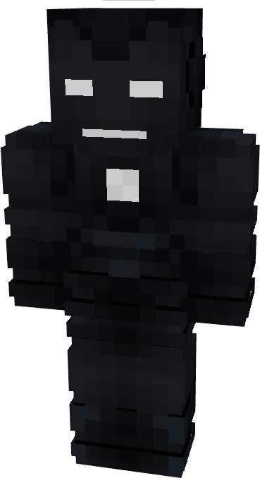

# Model VI

{ width="191" height="349" loading=lazy }

The **Iron Man (Model VI)** is crafted in the Tailoring Table with x2 Iron Circuits, x2 Gold Circuits, a Template I suitset, x6 Black Fabric, x6 Gray Fabric, and the Iron Man Model VI blueprint and can be repaired in an anvil with [Basic Stark Repair Kit](../../items/technology/stark-repair-kits/1-basic-stark-repair-kit.md).

**Stats**:

* **Armor Rating:** 20
* **Armor Toughness:** 4
* **Attack Damage bonus:** +2
* **Flight Speed:** 0.5
* **Fall Resistance:** 21

**Abilities:**

* **Slot 1 (Non-Crouch):** **"Repulsor Blast"** - Fire a single shot of repulsor energy that deals 3 damage on hit, with a cooldown of 1 second before you can fire again. 
* **Slot 2 (Non-Crouch): "Repulsor Beam"** - Fire a continuous beam of repulsor energy that deals 5 damage on hit that can be held for 10 seconds before needing to recharge

**Additional Information**:

* On a single press of the crouch key, this armor can turn partially invisible, draining energy whilst active and will disengage any hostile mob tracking you. Crouching again will render the armor fully visible. 
* Walking around with this armor will not send signals to Sculk Sensors.
* This Suits's recipe becomes unlocked after crafting the Model IV suit.
