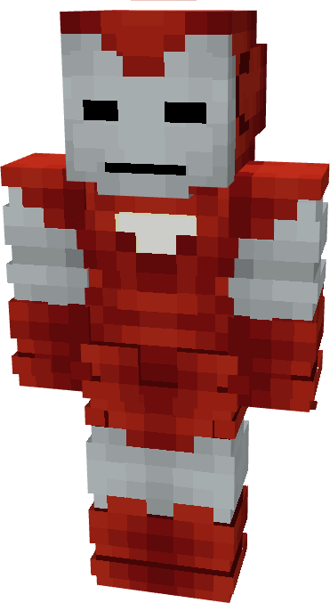

# Model VII

{ width="193" height="351" loading=lazy }

The **Iron Man (Model VII)** is crafted in the Tailoring Table with x2 Iron Circuits, x2 Gold Circuits, a Template I suitset, x6 Red Fabric, x6 Light Gray Fabric, and the Iron Man Model VII blueprint and can be repaired in an anvil with [Basic Stark Repair Kit](../../items/technology/stark-repair-kits/1-basic-stark-repair-kit.md).

**Stats**:

* **Armor Rating:** 20
* **Armor Toughness:** 4
* **Attack Damage bonus:** +2
* **Flight Speed:** 1.2
* **Fall Resistance:** 31

**Abilities:**

* **Slot 1 (Non-Crouch):** **"Repulsor Beam"** - Fire a continuous beam of repulsor energy that deals 5 damage on hit that can be held for 10 seconds before needing to recharge.
* **Slot 2 (Non-Crouch): "Unibeam**" - Fire a continuous beam of repulsor energy from your chest reactor that deals 18 damage on hit that can be held for 5 seconds before needing to recharge.
* **Slot 3 (Non-Crouch):** **"Energy Shield"** - Project a bubble around yourself that locks movement and blocks any incoming damage that can be held for 10 seconds before needing to recharge.
* **Slot 4 (Non-Crouch):** **"Energy Blade"** - Focus repulsor energy into a blade of pure energy coming from the repulsor core on your gauntlet, giving you 8 damage per hit at the cost of high energy drain.

**Related Information**

* This Suits's recipe becomes unlocked after crafting the Model VI suit.
