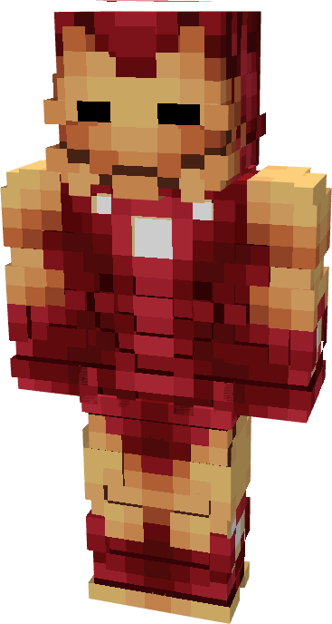

# Model LXX

{ width="224" height="418" loading=lazy }

The **Iron Man (Model LXX)** is crafted in the Tailoring Table with 4 Diamond Circuits, 4 Titanium Circuits, a Template II suitset, 6 Red Reinforced Fabric, 6 Yellow Reinforced Fabric, and the Iron Man Model LXX blueprint. The armor can be repaired in an anvil with "[Bleeding Edge Stark Repair Kit](../../items/technology/stark-repair-kits/3-advanced-stark-repair-kit.md)" in an anvil.

**Stats**:

* Armor Rating: 32
* Armor Toughness: 8
* Base Attack Damage: +6
* Flight Speed: 1.6
* Fall Resistance: 100

**Main Abilities**:

* **Slot 1 (Non-Crouch)**: **"Repulsor Beam" -** Fire a continuous beam of repulsor energy that deals damage on hit that can be held for 10 seconds before needing to recharge. This armor has an adjustable repulsor damage output up to a max of 4 that can be adjusted by crouching and using the ability key:
  * Output 1 - 5 damage
  * Output 2 - 8 damage
  * Output 3 - 13 damage
  * Output 4 - 16 damage
* **Slot 2 (Non-Crouch): "Unibeam" -** Fire a continuous beam of repulsor energy from your chest reactor that deals damage on hit that can be held down for 5 seconds before needing to recharge. This armor has an adjustable unibeam damage output up to a max of 3 that can be adjusted by crouching and using the ability key:
  * Output 1 - 18 damage
  * Output 2 - 22 damage
  * Output 3 - 26 damage
* **Slot 3 (Crouch):** **"Swap Munitions"** - Crouching and using the ability key gives you the option to change the type of munition that will be fired:
  * **"Kinetic Micro Missile"** - Fire a medium range missile that explodes on impact, dealing 3 explosive damage.
  * **"Concussive Blast"** - fire off a burst of concussive wind which inflicts the target with Sound Poisoning for 4 seconds which applies Slowness II, Nausea II, and 2 sound damage over time.
  * **"Taser Launcher"** - Fire a single electric charge which inflicts Shock II and EMP, for 5 seconds which deals 2 shock damage over time and disables the target’s technology based powers.
* **Slot 4 (Non-Crouch):** "Energy Shield" **-** Project a bubble around yourself that locks movement and blocks any incoming damage that can be held for 15 seconds before needing to recharge.
* **Slot 5 (Non-Crouch): "Iron Skates" -** Pop out the roller blades embedded in your boots and thrust yourself forward with your palm repulsors to greatly increase your land traversal speed and step height.

**Additional Information:**

* This armor has complete immunity to sound and fire damage.
* This Suits's recipe becomes unlocked after crafting the Model LXIII suit.
