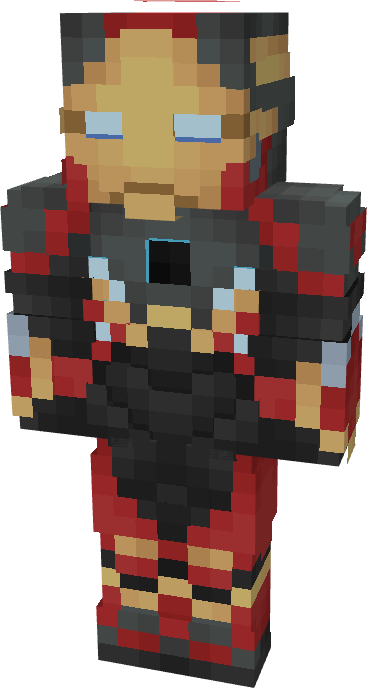

# Model LXXII

{ width="201" height="375" loading=lazy }

The **Iron Man (Model LXXII)** is crafted in the Tailoring Table with 4 Netherite Circuits, 4 Titanium Circuits, a Template IV suitset, 4 Red Tri Polymer Fabric, 4 Yellow Tri Polymer Fabric, 4 Black Tri Polymer Fabric, 3 Gray Fabric, 24 [Mysterium Ingots](../../blocks/ores/mysterium.md), and the Iron Man Model LXXII blueprint. The armor can be repaired in an anvil with Mysterium Ingots.

**Stats**:

* **Armor Rating:** 42
* **Armor Toughness:** 12
* **Attack Damage bonus:** +8
* **Flight Speed:** 1.65
* **Fall Resistance:** 100

**Abilities**:

* **Slot 1 (Non-Crouch)**: **"Repulsor Beam"** - Fire a continuous beam of repulsor energy that deals damage on hit that can be held for 10 seconds before needing to recharge. This armor has an adjustable repulsor damage output up to a max of 4 that can be adjusted by crouching and using the ability key:
  * Output 1 - 7 damage
  * Output 2 - 10 damage
  * Output 3 - 15 damage
  * Output 4 - 18 damage
* **Slot 2 (Non-Crouch): "Unibeam"** - Fire a continuous beam of repulsor energy from your chest reactor that deals damage 18 on hit that can be held down for 5 seconds before needing to recharge.
  * Output 1 - 20 damage
  * Output 2 - 24 damage
  * Output 3 - 28 damage
  * Output 4 - 32 damage
* **Slot 3 (Non-Crouch):** **"Kinetic Micro Missile"** - Fire a medium range missile that explodes on impact, dealing 3 explosive damage.

Additional Information:

* Thanks to the cosmic properties of [Mysterium](../../blocks/ores/mysterium.md), this armor is completely immune to magic and explosive damage, and its repulsors and unibeam damage outputs are slightly higher than that of standard Iron Man armor.
* In combination with the Netherite-Mysterium plating, this armor is immune to explosion and arrow damage.
* This Suits's recipe becomes unlocked after crafting the Model LXX suit.
