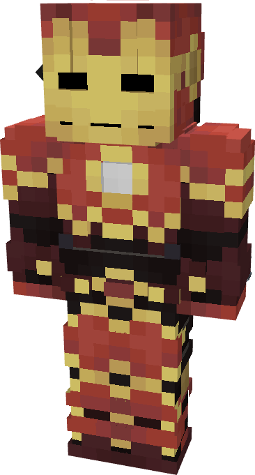

# Model LXXIV - Improvised

{ width="200" height="371" loading=lazy }

The **Iron Man (Model LXXIV)** is crafted in the Tailoring Table with 4 Gold Circuits, 4 Diamond Circuits, a Template II suitset, 6 Red Reinforced Fabric, 6 Yellow Reinforced Fabric, an Iron Sword, and the Iron Man Model LXXIV blueprint. The armor can be repaired in an anvil with [Modular Stark Repair Kits](../../items/technology/stark-repair-kits/2-enhanced-stark-repair-kit.md).

**Stats**:

* **Armor Rating:** 28
* **Armor Toughness:** 8
* **Attack Damage bonus:** +4
* **Flight Speed:** 0.75
* **Fall Resistance:** 100

**Abilities**:

* **Slot 1 (Non-Crouch)**: **"Repulsor Beam"** Repulsor Beam - Fire a continuous beam of repulsor energy that deals damage on hit that can be held for 10 seconds before needing to recharge. This armor has an adjustable repulsor damage output up to a max of 4 that can be adjusted by crouching and using the ability key:
  * Output 1 - 5 damage
  * Output 2 - 8 damage
* **Slot 2 (Non-Crouch):** **"Repulsword Beam Slash"** - With your Repulsword drawn, stand in place and fire a continuous beam of repulsor energy that deals 16 damage on hit that can be held for 10 seconds before needing to recharge.
* **Slot 3 (Crouch):** **"Swap Munitions"** - Crouching and using the ability key gives you the option to change the type of munition that will be fired:
  * **"Kinetic Micro Missile"** - Fire a medium range missile that explodes on impact, dealing 3 explosive damage.
  * **"Concussive Blast"** - fire off a burst of concussive wind which inflicts the target with Sound Poisoning for 4 seconds which applies Slowness II, Nausea II, and 2 sound damage over time.
  * **"Taser Launcher"** - Fire a single electric charge which inflicts Shock II and EMP, for 5 seconds which deals 2 shock damage over time and disables the target’s technology based powers.
* **Slot 4 (Non-Crouch):** **"Draw Repulsword"** - Draw the Repulsword from your back and wield it, increasing your physical damage to 17. Holding the key will block all incoming damage for 10 seconds before needing to recharge.
  * Crouching and using the ability key will sheathe the Repulsword.

**Related Information**

* This Suits's recipe becomes unlocked after crafting the Model LXXII suit.
