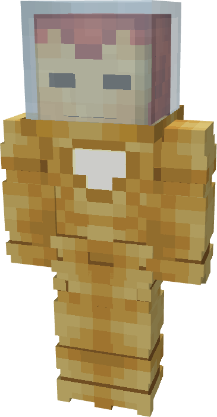

# Model VIII

{ width="155" height="297" loading=lazy }

The **Iron Man (Model VIII)** is crafted in the Tailoring Table with x2 Iron Circuits, x2 Gold Circuits, a Template I suitset, x3 Red Fabric, x3 Light Gray Fabric, and the Iron Man Model VIII blueprint and can be repaired in an anvil with [Stark Repair Kits](../../items/technology/stark-repair-kits/1-basic-stark-repair-kit.md).

**Stats**:

* **Armor Rating:** 20
* **Armor Toughness:** 4
* **Attack Damage bonus:** +2
* **Flight Speed:** 1
* **Fall Resistance:** 31

**Abilities:**

* **Slot 1 (Non-Crouch)**: **"Repulsor Beam"** - Fire a continuous beam of repulsor energy that deals 5 damage on hit that can be held for 10 seconds before needing to recharge.
* **Slot 2 (Non-Crouch): "Unibeam"** - Fire a continuous beam of repulsor energy from your chest reactor that deals 18 damage on hit that can be held for 5 seconds before needing to recharge

**Additional Information**:

* This armor is able to move around freely whilst submerged in water as if the player were traversing on land. In addition, being fully submerged also gives the player infinite water breathing and night vision.
* This Suits's recipe becomes unlocked after crafting the Model VII suit.
