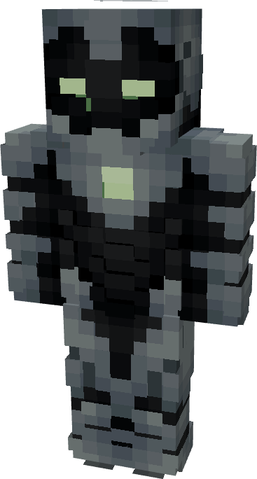

# Model NIL

{ width="224" height="417" loading=lazy }

The **Iron Man (Model NIL)** is crafted in the Tailoring Table with 4 Gold Circuits, 4 Diamond Circuits, a Template II suitset, 4 Black Reinforced Fabric, 6 Light Gray Reinforced Fabric, and the Iron Man Model NIL blueprint.. The armor can be repaired in an anvil with [Modular Stark Repair Kits](../../items/technology/stark-repair-kits/2-enhanced-stark-repair-kit.md).

**Stats**:

* **Armor Rating:** 28
* **Armor Toughness:** 8
* **Attack Damage bonus:** +1
* **Flight Speed:** 1.64
* **Fall Resistance:** 61

**Abilities**:

* **Slot 1 (Non-Crouch)**: **"Repulsor Beam"** - Fire a continuous beam of repulsor energy that deals damage on hit that can be held for 10 seconds before needing to recharge. This armor has an adjustable repulsor damage output up to a max of 4 that can be adjusted by crouching and using the ability key:
  * Output 1 - 5 damage
  * Output 2 - 8 damage
  * Output 3 - 13 damage
* **Slot 2 (Non-Crouch): "Unibeam"** - Fire a continuous beam of repulsor energy from your chest reactor that deals damage 18 on hit that can be held down for 5 seconds before needing to recharge.
* **Slot 3 (Non-Crouch):** Taser Launcher - Fire a single electric charge which inflicts Shock II and EMP, for 5 seconds which deals 2 shock damage over time and disables the target’s technology based powers.
* **Slot 4:** Energy Blade - Focus repulsor energy into a blade of pure energy coming from the repulsor core on your gauntlet, giving you 10 damage per hit at the cost of high energy drain.
* **Ability 5:** Enable Stealth Mode - turn your suit completely invisible with no shadow, draining energy whilst active and will disengage any hostile mob tracking you.

**Additional Information:**

* Walking around with this armor will not send signals to Sculk Sensors.
* This Suits's recipe becomes unlocked after crafting the Model LXX suit.
