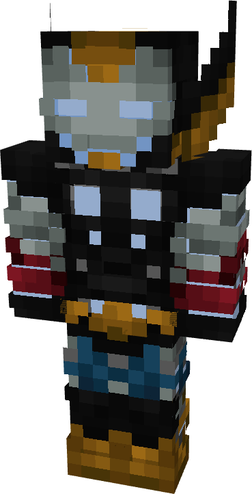

# Model THDR

{ width="201" height="392" loading=lazy }

The **Iron Man (Model THDR)** is crafted in the Tailoring Table with 4 Gold Circuits, 4 Diamond Circuits, a Template II suitset, 4 Black Reinforced Fabric, 6 Gray Reinforced Fabric, 2 Blue Reinforced Fabric, and the Iron Man Model THDR blueprint. The armor can be repaired in an anvil with [Modular Stark Repair Kits](../../items/technology/stark-repair-kits/2-enhanced-stark-repair-kit.md).

**Stats**:

* **Armor Rating:** 32
* **Armor Toughness:** 8
* **Attack Damage bonus:** +2
* **Flight Speed:** 1.6
* **Fall Resistance:** 51

**Abilities**:

* **Slot 1 (Non-Crouch)**: **"Repulsor Beam"** - Fire a continuous beam of repulsor energy that deals damage on hit that can be held for 10 seconds before needing to recharge. This armor has an adjustable repulsor damage output up to a max of 4 that can be adjusted by crouching and using the ability key:
  * Output 1 - 5 damage
  * Output 2 - 8 damage
  * Output 3 - 13 damage
  * Output 4 - 16 damage
* **Slot 2 (Non-Crouch):** "**Quadbeam"** - Fire four continuous beams of repulsor energy together from your reactor and the two extra repulsor nodes on your chest that deal damage 25 on hit that can be held down for 5 seconds before needing to recharge.
* **Slot 3 (Crouch):** **"Swap Munitions"** - Crouching and using the ability key gives you the option to change the type of munition that will be fired:
  * **"Kinetic Micro Missile"** - Fire a medium range missile that explodes on impact, dealing 3 explosive damage.
  * **"Concussive Blast"** - fire off a burst of concussive wind which inflicts the target with Sound Poisoning for 4 seconds which applies Slowness II, Nausea II, and 2 sound damage over time.
  * **"Taser Launcher"** - Fire a single electric charge which inflicts Shock II and EMP, for 5 seconds which deals 2 shock damage over time and disables the target’s technology based powers.
* **Slot 4 (Non-Crouch):** **"Energy Shield"** - Project a bubble around yourself that locks movement and blocks any incoming damage that can be held for 15 seconds before needing to recharge.
* **Slot 4 (Crouch): "Lightning Sword"** - Channel your repulsor energy into a blade of electric energy, increasing your physical damage to 13. Crouching and using the ability key again will disable the ability.

**Related Information**

* This Suits's recipe becomes unlocked after crafting the Model LI suit.
