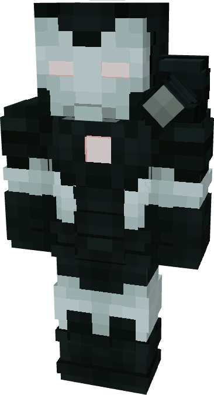

# Model I

{ width="205" height="376" loading=lazy }

The **War Machine (Model I)** is crafted in the Tailoring Table with 2 Iron Circuits, 2 Gold Circuits, a Template I suitset, 6 Black Fabric, 6 Gray Fabric, and the War Machine Model I blueprint. The armor can be repaired in an anvil with [Stark Repair Kits](../../../items/technology/stark-repair-kits/1-basic-stark-repair-kit.md).

**Stats**:

* **Armor Rating:** 32
* **Armor Toughness:** 8
* **Attack Damage bonus:** +2
* **Flight Speed:** 0.75
* **Fall Resistance:** 51

**Abilities**:

* **Slot 1 (Non-Crouch)**: **"Repulsor Beam"** - Fire a continuous beam of repulsor energy that deals damage on hit that can be held for 10 seconds before needing to recharge. This armor has an adjustable repulsor damage output up to a max of 4 that can be adjusted by crouching and using the ability key:
  * Output 1 - 5 damage
  * Output 2 - 8 damage
  * Output 3 - 12 damage
* **Slot 2 (Non-Crouch): "Unibeam"** - Fire a continuous beam of repulsor energy from your chest reactor that deals damage 18 on hit that can be held down for 5 seconds before needing to recharge.
* **Slot 3 (Non-Crouch):** **"Micro-Missile Barrage" -** continuously fire a barrage of missiles from your gauntlets that deal 3 explosion damage on hit that can be held for 3 seconds before needing to recharge.
* **Slot 4 (Non-Crouch):** **"Shoulder Minigun"** - Rev up the shoulder mounted minigun and fire off rapid fire shots that deal 4 damage on hit. Each hit applies Wither III on the target for 3 seconds.

Additional Information:

* This armor is completely immune to arrows.
* This Suits's recipe becomes unlocked after crafting the Model IX suit.
